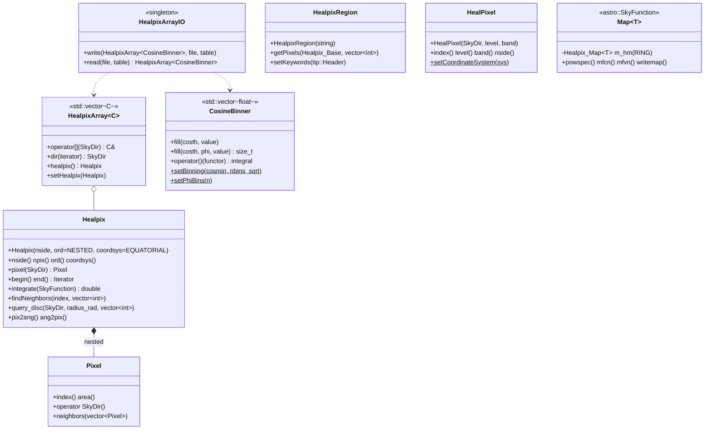

# healpix Architecture

**healpix** is a thin Fermi layer over the external **healpix_cxx**
library (HEALPix 3.31, built from `externals/healpix_cxx`). It adds
`astro::SkyDir` and `astro::SkyFunction` interfaces to HEALPix pixels,
gives "an array with one value per sky pixel" types, and defines the
`CosineBinner` cell and FITS I/O used by the **livetime cube**
(`gtltcube` output). It also has a disk-region helper used for
partial-sky HEALPix count maps, and some older spherical-harmonic
filtering code.

The package mixes code of very different ages and levels of use. The
`CosineBinner`/`HealpixArray`/`HealpixArrayIO` path and `HealpixRegion`
are on the critical path of the standard tools. `Map`, `AlmOp`,
`alm_filter_tools`, `HealpixMap` and much of `HealPixel` are used only by
the unbuilt `skymaps` package (see [Position in the system](#position-in-the-system)).

## Purpose and scope

**Does:**
- Convert between `astro::SkyDir` and HEALPix pixel indices
  (`Healpix`, `Healpix::Pixel`, `HealPixel`), and iterate over all pixels
  as an STL-style container (`Healpix::begin()/end()`), including
  integrating an `astro::SkyFunction` over the sphere.
- Store one value per pixel, addressable by `SkyDir`
  (`HealpixArray<C>`), and a sparse `int → float` map (`HealpixMap`).
- Bin livetime in cos(θ) (and optionally φ) per sky pixel
  (`CosineBinner`), and read/write a `HealpixArray<CosineBinner>` (or
  `<float>`, `<vector<float>>`) as a FITS binary table
  (`HealpixArrayIO`).
- Parse, format and evaluate partial-sky region strings
  `DISK(lon,lat,radius)` and `DISK_INC(lon,lat,radius,factor)`
  (`HealpixRegion`), and write the `HPX_REG` keyword.
- Wrap `Healpix_Map`/`Alm` for power spectra and matched or
  scale-adaptive filtering (`Map`, `AlmOp`, `alm_filter_tools`).

**Does not:**
- Implement HEALPix itself. All pixel geometry (`ang2pix`, `pix2ang`,
  `neighbors`, `query_disc`), map FITS I/O (`fitshandle`) and spherical
  transforms come from healpix_cxx.
- Provide a map projection. HEALPix as an `astro::ProjBase`
  (`astro::HealpixProj`, used by `astro::SkyProj`, `evtbin` and
  `Likelihood` for HEALPix count maps and their FITS keywords) lives in
  **astro**, which links healpix_cxx directly and does not depend on this
  package.
- Write standard HEALPix map files for the `gt*` tools. `evtbin`
  (`HealpixMap` data product) and `Likelihood` (`CountsMapHealpix`,
  `HealpixProjMap`) write their own HEALPix FITS output.
- Provide Python bindings in the CMake build (see
  [Public interfaces](#public-interfaces)).

### Boundary with healpix_cxx and astro

| Need | Use |
|------|-----|
| Raw pixel math, `Healpix_Base`, `Healpix_Map<T>`, `Alm<T>`, `rangeset`, map FITS I/O | healpix_cxx directly (`healpix_base.h`, `healpix_map.h`, …). `evtbin::HealpixBinner` does this. |
| A HEALPix "projection" that behaves like WCS (`sph2pix`/`pix2sph`, `setKeywords`, reading `PIXTYPE`/`ORDERING`/`NSIDE` from a file) | `astro::HealpixProj` (`astro/HealpixProj.h`) |
| `SkyDir` ↔ pixel, per-pixel arrays, livetime-cube cells and I/O, region strings | this package |

## Position in the system

| Direction | Package | Why |
|-----------|---------|-----|
| Depends on | `healpix_cxx` (external) | All HEALPix algorithms. Linked `PUBLIC`, and the public headers `HealpixRegion.h`, `Map.h`, `AlmOp.h` and `alm_filter_tools.h` include healpix_cxx headers, so clients need its include path. |
| Depends on | `astro` | `SkyDir` and `SkyFunction` appear throughout the API. Linked `PUBLIC`. |
| Depends on | `tip` | `HealpixArrayIO` reads and writes tables; `HealpixRegion::setKeywords` takes a `tip::Header`. Linked `PUBLIC`. |
| Depends on (undeclared) | `facilities` | `HealpixRegion.cxx` uses `facilities::Util::stringTokenize`/`stringToDouble`, and the test includes `facilities/commonUtilities.h`. `facilities` is not in `target_link_libraries`; it arrives transitively through `tip`'s and `astro`'s `PUBLIC` links. |
| Depends on | OpenMP | Linked `PRIVATE` (`OpenMP::OpenMP_CXX`). This sets `_OPENMP`, which enables the `#pragma omp` loops in `Map.cxx` and `alm_filter_tools.cxx`. |
| Used by | `Likelihood` | `CosineBinner` (static binning, `cosine_index`, `phi_index`) and `HealpixArray<CosineBinner>` in `LikeExposure`/`ExposureCube`/`gtltcube`; `HealpixRegion` in `CountsMapHealpix`. |
| Used by | `map_tools` | `map_tools::Exposure` *is* a `HealpixArray<CosineBinner>` and loads and saves the livetime cube through `HealpixArrayIO`. `Likelihood::ExposureCube` wraps it, so every livetime-cube read in the analysis goes through this package. |
| Used by | `evtbin` | `HealpixRegion` (the `hpx_region` parameter of `gtbin`), held by `HealpixBinner`. |
| Used by | `SolarSystemTools` | `HealpixArray<T>` with its own cell types (`CosineBinner2D`), `Healpix`, `HealpixArrayIO`. |
| Used by | `pyLikelihood` | SWIG-wraps `healpix/CosineBinner.h` (`pyLikelihood.i`). No direct link; it comes through `Likelihood`. |
| Used by (not built) | `skymaps` | Heaviest user of `Healpix`, `HealPixel`, `HealpixMap`, `Map`, `AlmOp`, `alm_filter_tools`. `skymaps` is not in the CMake build. |

`docs/architecture/dependency-layers.md` lists this package correctly
(tier `io`, depends on `astro`, `tip`; used by `Likelihood`,
`SolarSystemTools`, `evtbin`, `map_tools`). `pyLikelihood` also uses the
header, through SWIG.

## Key abstractions

All classes are in namespace `healpix`, except the free functions in
`alm_filter_tools.h`, which are in the global namespace.



| Type | Header | Role |
|------|--------|------|
| `Healpix` | `healpix/Healpix.h` | Value object: `nside`, ordering (`RING`/`NESTED`, default `NESTED`), coordinate system (default `EQUATORIAL`). Each call builds a temporary `Healpix_Base` (`int` index type). |
| `Healpix::Pixel`, `Healpix::Iterator`, `Healpix::Integrand` | `healpix/Healpix.h` | A pixel index plus a pointer to its `Healpix`. It converts to a `SkyDir` at the pixel centre. The iterator walks indices `0..npix-1`. Hidden from SWIG. |
| `HealpixArray<C>` | `healpix/HealpixArray.h` | `std::vector<C>` of size `npix`, plus a `Healpix`. `operator[](SkyDir)` finds the pixel and returns its element. Integer `operator[]` is the inherited vector one. |
| `CosineBinner` | `healpix/CosineBinner.h` | `std::vector<float>` of livetime per cos(θ) bin, optionally followed by `nbins × nphibins` φ bins. **Binning parameters are static, process-wide.** |
| `HealpixArrayIO` | `healpix/HealpixArrayIO.h` | Singleton that writes and reads `HealpixArray<CosineBinner \| float \| vector<float>>` to and from a FITS table with HEALPix header keywords. |
| `HealpixRegion` | `healpix/HealpixRegion.h` | A parsed region (`DISK` or `DISK_INC`) with parameters in degrees; it turns into a pixel list for a given `Healpix_Base`. |
| `HealPixel` | `healpix/HealPixel.h` | Compact NESTED pixel with an encoded `level` (nside = 2^level, 1–13) and an energy `band` (0–255). Uses a **static** coordinate system, default `GALACTIC`. |
| `HealpixMap` | `healpix/HealpixMap.h` | Sparse `std::map<int,float>` keyed by NESTED index at a fixed level. It is also an `astro::SkyFunction`, and saves and loads a simple text format. |
| `Map<T>`, `AlmOp<T>` | `healpix/Map.h`, `healpix/AlmOp.h` | Wrappers over `Healpix_Map<T>` (RING) and `Alm<T>` for power spectra and McEwen-style matched and scale-adaptive filters. Instantiated for `float`/`double` (`xcomplex<float/double>` for `AlmOp`). |
| `alm_filter_tools` | `healpix/alm_filter_tools.h` | Free function templates: `mf_constantnoise`, `mf_noise`, `saf_constantnoise`, `saf_noise`, dilated `map2almdil`/`map2alm_iterdil`, and `lhood`. |

## Data flow and control flow

### Livetime cube (the main production path)

```
gtltcube (Likelihood/makeExposureCube)
  CosineBinner::setBinning(cosmin=0, nbins=1/dcostheta, sqrt=true)   // static, before any cell exists
  CosineBinner::setPhiBins(phibins)                                  // optional
  LikeExposure (map_tools::Exposure = HealpixArray<CosineBinner>, NESTED, EQUATORIAL)
    for each FT2 interval, for each pixel: CosineBinner::fill(costh[, phi], livetime)
  LikeExposure::writeFile → its own tip code (EXPOSURE + WEIGHTED_EXPOSURE + CTHETABOUNDS)

gtexpcube2 / gtsrcmaps / pyLikelihood
  Likelihood::ExposureCube → map_tools::Exposure(file, "EXPOSURE")
    HealpixArrayIO::read(file, table)
      read NSIDE, ORDERING, COORDSYS (or legacy COORDTYPE), THETABIN, NBRBINS, COSMIN, [PHIBINS]
      CosineBinner::setBinning(...) / setPhiBins(...)   // overwrites the process-wide binning
      HealpixArray<CosineBinner>(Healpix(nside, ord, coordsys))
      copy the COSBINS vector cell of each row into each pixel
  ExposureCube::value(dir, costh, phi) → data()[dir] → CosineBinner::cosine_index / phi_index
```

`gtltcube` does not write the file through `HealpixArrayIO`; it writes the
same keywords itself (`LikeExposure.cxx`). `map_tools`'s internal
`exposure_cube` executable does use `HealpixArrayIO::write`.

### Partial-sky HEALPix binning

```
gtbin algorithm=HEALPIX hpx_region="DISK(83.6,22.0,10)"
  evtbin::HealpixBinner(..., region)
    new healpix::HealpixRegion(region)     // parseString: tokenize on ",()"
    HealpixRegion::getPixels(Healpix_Base, pixelIndices)
      DISK     → Healpix_Base::query_disc(pointing(θ,φ), rad)            // centres inside
      DISK_INC → Healpix_Base::query_disc_inclusive(..., factor)         // pixels overlapping
    HealpixRegion::setKeywords(header) → HPX_REG = original string
```

`Likelihood::CountsMapHealpix` reads the region back from the binner
(`getRegionSize`) to set its map radius.

## Public interfaces

### C++ API

Headers in `healpix/`:

- **Used by built consumers:** `CosineBinner.h`, `HealpixArray.h`,
  `HealpixArrayIO.h`, `Healpix.h`, `HealpixRegion.h`.
- **Used only by unbuilt `skymaps`:** `HealPixel.h`, `HealpixMap.h`,
  `Map.h`, `AlmOp.h`, `alm_filter_tools.h`.
- **`HeallpixMap.h` (note the double "l")** is a stale, uncompilable
  duplicate of `HealpixMap.h`, with the same include guard. It is still
  installed. Do not include it.

Idiomatic use of the livetime-cube types:

```cpp
#include "healpix/CosineBinner.h"
#include "healpix/HealpixArray.h"
#include "healpix/HealpixArrayIO.h"

using namespace healpix;
CosineBinner::setBinning(0., 40, true);   // set BEFORE constructing any CosineBinner
HealpixArray<CosineBinner> cube(Healpix(64, Healpix::NESTED, astro::SkyDir::EQUATORIAL));
cube[astro::SkyDir(83.6, 22.0)].fill(0.9, 30.);   // costheta, livetime
HealpixArrayIO::instance().write(cube, "ltcube.fits", "EXPOSURE");  // returns unique_ptr<tip::Table>: let it die to close
```

### Applications

None. The package builds the `healpix` shared library and the
`test_healpix` executable. `test_healpix` is installed to `bin/` along
with the library.

### Python

None in the CMake build. `src/swig_setup.in` and `healpixLib.py` belong
to the legacy SCons build. `swig_setup.in` refers to a nonexistent
`healpix/HealPixMap.h`. `CosineBinner` is visible from Python only through
`pyLikelihood`.

### Environment variables

None (no `getenv`). Variables set by conda activation are described under
"Runtime environment" in ScienceTools' `docs/architecture/README.md`.

### File formats

`HealpixArrayIO` writes a binary table extension named by the caller. It
is appended to the file, after deleting the file first when
`clobber=true`. The table has:

| Item | `HealpixArray<CosineBinner>` | `<float>` | `<vector<float>>` |
|------|------------------------------|-----------|-------------------|
| Columns | `COSBINS` (`nE`, n = cell size) | one `1E` column, named by the caller | one `1E` column per name given |
| Keywords | `ORDERING` (`NESTED`/`RING`), `COORDSYS` (`GAL`/`EQU`), `NSIDE`, `FIRSTPIX`=0, `LASTPIX`, `NAXIS1` | same | same |
| Extra keywords | `THETABIN` (`SQRT(1-COSTHETA)` or `COSTHETA`), `NBRBINS`, `COSMIN`, `PHIBINS` | — | — |

On read, `COORDTYPE` is accepted as a legacy alias for `COORDSYS`, and
`PHIBINS` is optional.

`HealpixMap::save/load` uses a text format: the level on the first line,
then `index<TAB>value` lines. `Map<T>::writemap` writes a standard HEALPix
map through healpix_cxx (`PLANCK_FLOAT64`).

## Build and test

- **CMake target:** `healpix` (shared library). Links `PUBLIC
  healpix_cxx::healpix_cxx astro tip` and `PRIVATE OpenMP::OpenMP_CXX`.
  Exported in `fermiTargets`. Headers are installed to
  `${FERMI_INSTALL_INCLUDEDIR}/healpix`.
- **Data:** `data/` is installed to `${FERMI_INSTALL_DATADIR}`
  (`share/fermitools/data/`) **without a package subdirectory**, so the
  file `Healpix Neighbors Nside=8.txt` (with spaces) and `srctest.fits`
  land at the top of the shared data directory.
  `facilities::commonUtilities::getDataPath("healpix")` resolves to
  `.../refdata/fermi/healpix`, which is not where they are installed.
  Only disabled test code uses them.
- **Test executable:** `test_healpix` (`src/test/test_healpix.cxx`). It is
  **not registered with CTest**, so run it by hand. It returns non-zero on
  failure.
  - Everything except the `CosineBinner` checks is inside `#if 0`: the
    `Map` filter test, the `HealPixel` neighbours test, `TestHealpix`
    (which would read the neighbours file through `getDataPath`) and
    `TestHealpixArray`. So the test only checks `CosineBinner` binning,
    φ folding and integrals, needs no environment variables or data, and
    writes no files.
  - The default run of the project harness `recipe/tests/ST-unit-test`
    (see "Testing" in ScienceTools' `docs/architecture/README.md`) runs
    `test_healpix` and checks only its exit status. No output is compared
    and no healpix reference data exists anywhere.
  - **`Healpix`, `HealpixArray`, `HealpixArrayIO`, `HealpixRegion` and
    `Map` have no active tests here.** Their real coverage is indirect,
    through `map_tools`, `Likelihood` (livetime cubes) and `evtbin`
    (`gtbin` HEALPIX) tests.
- **Legacy:** `SConscript`, `healpixLib.py`, `src/swig_setup.in`,
  `.cvsignore`. `doc/release.notes` stops at 2017 (healpix-02-05-03); later
  history is in git. `src/mainpage.h` is a 2006 stub that lists only
  `AlmOp`, `Healpix`, `HealPixel`, `HealpixArray` and `Map`.
- **CI:** `azure-pipelines.yml` uses the shared `fermi-lat/ci` templates.

## Invariants and gotchas

**Global state**
- `CosineBinner`'s binning (`s_cosmin`, `s_nbins`, `s_sqrt_weight`,
  `s_phibins`) is **static and shared by the whole process**. A cell's size
  is fixed at construction (`nbins` or `nbins*(1+nphibins)`), but every
  index computation uses the current statics. `HealpixArrayIO::read`
  **overwrites** them from the file's header. Loading two livetime cubes
  with different binning in one process (for example pyLikelihood with
  two ltcubes) silently mis-indexes the first one. `map_tools::Exposure`'s
  constructor also calls `setBinning`.
- `HealPixel`'s coordinate system is a static, **defaulting to
  `GALACTIC`**, while `Healpix` defaults to `EQUATORIAL`.
  `Map<T>::operator()(SkyDir)` and `HealpixMap::operator()` go through
  `HealPixel`, so they read the sky in Galactic coordinates unless someone
  calls `HealPixel::setCoordinateSystem`.

**Units and conventions**
- `Healpix::query_disc` takes the radius in **radians**.
  `HealpixRegion` parameters (`DISK(lon,lat,radius)`) are in **degrees**,
  in whatever frame the map uses. The region carries no frame of its own.
- `Healpix` works in RA/Dec or l/b according to `coordsys`, and converts
  to θ = 90° − lat, φ = lon. `Pixel(SkyDir)` writes φ as
  `M_PI/180 * ra` by starting `phi` at `M_PI/180` and multiplying. This is
  correct, but easy to misread.
- `Map<T>(int level)` and `HealPixel(…, level)` use **order** (nside = 2^level).
  The doc comment in `Map.h` ("level = 12*2**nside") is wrong.
  `HealPixel` throws for levels outside 1–13. Its header says 0–13, and
  this means `Map<T>` at order 0 cannot be evaluated.
- `Map<T>` always stores a **RING** map. It converts through
  `ring2nest`/`nest2ring` when it uses `HealPixel` (NESTED).

**HealpixArrayIO**
- `write` with `clobber=true` throws only if `remove()` fails with
  `EACCES`. With `clobber=false`, it **appends another extension** with the
  same name to an existing file.
- `write` returns the open `tip::Table` as a `unique_ptr`. The file is
  finished only when that pointer is destroyed.
- `write` sets `NAXIS1` explicitly (`columns*4`), overwriting the
  structural keyword that cfitsio maintains. It agrees with the real row
  width only because every column is `E`.
- `read` copies table rows into the array until the **table** ends. A file
  with more rows than `12*NSIDE²` would write past the end of the vector
  (from reading the code; not checked at runtime). It also does not
  release the table if an exception is thrown (raw `delete &table`).
- `write<CosineBinner>` asserts that all cells have the size of `ha[0]`
  (only with `assert` enabled).

**HealpixRegion**
- `buildString` (used by the `HealpixRegion(RegionType, pars)` constructor)
  formats `pars[3]` (a `float`) with `%i`, and has **no `return` on its
  success path** in an `int` function. A `DISK_INC` region built from
  parameters gets a garbage `factor` in `asString()`/`HPX_REG`, and the
  return value is undefined (from reading the code; not checked at
  runtime). Building from a string, which is what `evtbin` does, is not
  affected.
- `getPixels` with `UNKNOWN_REGION` returns an empty list and no error.
  `getRefDir`/`getRegionSize` throw for an unknown region.
- Indices are `int` (`Healpix_Base` is `T_Healpix_Base<int>`), so nside is
  limited to 8192.

**Map / AlmOp / filters (legacy, skymaps-only)**
- `AlmOp::operator*` multiplies **real×real and imag×imag separately**. It
  is not complex multiplication.
- The dilation factor is `R = tan(angle/2)/tan(45.0)`, and `tan(45.0)` is
  **45 radians**. `mfcn(psffile, lmax)` also has `1/50000` (integer
  division, so 0). `mfvn` uses the angle in degrees where `mfcn(lmax, E)`
  converts to radians. All of this is from reading the code; not checked
  at runtime.
- `Map(const SkyFunction&, level)` evaluates the function **in parallel**
  (OpenMP) when OpenMP is on, so the `SkyFunction` must be thread-safe.
- `Map.h`, `AlmOp.h` and `alm_filter_tools.h` have **no include guards**.
  `alm_filter_tools.h` declares anonymous-namespace helpers in a header.

**Smaller traps**
- `Healpix::Iterator`'s traits are wrong (`value_type` is `Healpix`, not
  `Pixel`). It works with `std::accumulate`, but not with algorithms that
  rely on the traits.
- `HealPixel::operator<` subtracts the packed `level<<8 | band` words and
  treats the difference as a level difference. Pixels with the same level
  but different bands are compared with a shift by the band difference,
  and pixels with different levels shift by hundreds of bits, which is
  undefined (from reading the code; not checked at runtime).
- `CosineBinner::operator[](costh) const` and `operator()(costh, phi)` do
  not clamp the index to `nbins-1` the way the non-const `operator[]` and
  `fill(costh, phi, v)` do. For `cos θ ≤ cosmin`, the index lands in the
  φ-bin region when φ binning is on, so it silently returns a φ bin.
  Otherwise `at()` throws `std::out_of_range`. `fill` silently drops
  `cos θ ≤ cosmin`.
- `HealpixMap::load` reads until EOF with `while(!in.eof())`. A trailing
  newline can repeat the last entry (it is harmless, because it is
  assigned to the same key).

## Extension points

- **New per-pixel quantity:** use `HealpixArray<YourCell>`. `SolarSystemTools`
  does this with `CosineBinner2D`. To persist it, add a `write`/`read`
  overload pair to `HealpixArrayIO`, following the `vector<float>` version,
  or write it with tip directly, as `LikeExposure` does.
- **New region shape:** add an enum value to `HealpixRegion::RegionType`,
  a branch in `parseString`, `buildString`, `getPixels`, `getRefDir` and
  `getRegionSize`, and a static `query_*` helper using the matching
  `Healpix_Base` query (`query_polygon`, `query_strip`, …). `evtbin` and
  `Likelihood` pick it up through the `hpx_region` string.
- **Changing `CosineBinner` binning semantics** changes the livetime-cube
  file format (`THETABIN`/`NBRBINS`/`COSMIN`/`PHIBINS`). Check
  `Likelihood/src/LikeExposure.cxx` (writer),
  `Likelihood/src/ExposureCube.cxx` (`cosine_index`/`phi_index` users) and
  `map_tools/src/Exposure.cxx`, and keep old files readable.

Run `test_healpix`, and the `map_tools`, `Likelihood` and `evtbin` tests,
because the healpix tests barely cover the code.

## Further reading

- healpix_cxx 3.31 documentation (`Healpix_Base`, `Healpix_Map`, `Alm`):
  <https://healpix.sourceforge.io/html/Healpix_cxx/index.html>. The
  external build is in `externals/healpix_cxx/CMakeLists.txt` (with
  `healpix_cxx.patch`).
- `astro::HealpixProj`: `src/astro/astro/HealpixProj.h`.
- Livetime cube writer: `src/Likelihood/src/LikeExposure.cxx`. Reader:
  `src/map_tools/src/Exposure.cxx`.
- Partial-sky binning: `src/evtbin/doc/architecture/README.md`
  (`HealpixBinner`, `HealpixMap`).
- Matched and scale-adaptive filters on the sphere: McEwen et al.,
  astro-ph/0612688 (cited in `alm_filter_tools.h`).
- `doc/release.notes`: history up to 2017.
